# The Exchange Everyone Asked For but Nobody Shipped

### NEAR pivoted into a real business. Now it has to get paid for it.

**0xyuji**

[0xyuji.github.io/exhibit-a](https://0xyuji.github.io/exhibit-a/)

Version 1 · as of 28 November 2026 · data from 28 October 2026 to 26 November 2026

*Every number, table and figure below is written by `python3 build.py` from the sources in Section 2. The few we read by hand (five figures from two public dashboards) are in `data/notes.json`. A daily job rebuilds them, so figures can differ a little from the demo video, which was recorded on 14 November 2026. Also as a [PDF](https://0xyuji.github.io/exhibit-a/exhibit-a-thesis.pdf) and as live charts on the [dashboard](https://0xyuji.github.io/exhibit-a/).*

## Abstract

NEAR Intents settles swaps that begin inside other companies' wallets. We counted every partner swap of a 30-day window (715,169 attempted, 658,719 completed, worth $1.41B) from NEAR's own API, checked the totals against the official series, and read wallet balances, token supply and contract state straight from the chain. (1) The venue has customers who pay: partners charged users $6.8M, 48 bps on average, and holders of coins with no exchange on their own chain supply 68% of those fees. (2) In about a week 99% of the volume went private, and daily volume didn't flinch. (3) NEAR keeps very little of it: a NEAR wallet is named on 3% of partner fees, and official revenue of $1.7M covers 21.0% of the dollar value of new NEAR issuance. (4) And the share NEAR keeps is already rising: 10% of gross fees in November 2025, 34% in October 2026. So the business is real, and what the token gets out of it is, for now, a rounding error on a fee somebody else collects. The thing to watch isn't volume. It's the cut. We argue the bear case as hard as the bull case, list 9 things that would change our mind (1 is tripped today), and publish the code so you can re-run all of it.

## 1. Introduction

Picture someone with a hardware wallet. They hold Bitcoin, they want dollars, they tap "swap" inside the wallet's app, and a minute later it's done. They paid about 84 bps for the privilege. Ask them which blockchain did the work and you'll get a blank stare.

It was NEAR.

For years you had to pick. A big exchange was simple and kept your trades off the public record, but it wanted your ID and it held your coins. A DEX let you keep your coins, but everything was public, and it couldn't swap a coin like Bitcoin on its own chain. NEAR has become the exchange everyone asked for but nobody shipped:

- **Private and simple like a CEX, without the formalities.** Send in one coin, take out another. Nothing public links the two, and nobody asks for your ID.
- **Yours, and fair, like a DEX.** It starts and ends in your own wallet. No account, and no house setting the price: solvers compete for your swap.

How did it get here? NEAR started in AI, became a chain, went back to AI, and somewhere along the way built the thing that actually works: a venue that settles swaps which begin inside other people's wallets. It has customers who pay. It has money sitting inside it. It has an operator who sees the flow. What it doesn't have is an order book... and since early November it doesn't have much you can see on-chain either.

**Our claim: this is the business NEAR's long-term value rests on, and it's worth owning for years on one condition. NEAR has to start keeping more of what the business earns.** Partners charge users 48 bps on average. A NEAR wallet is named on 3% of that. The distribution is there. The pricing power is there. The capture isn't. Yet.

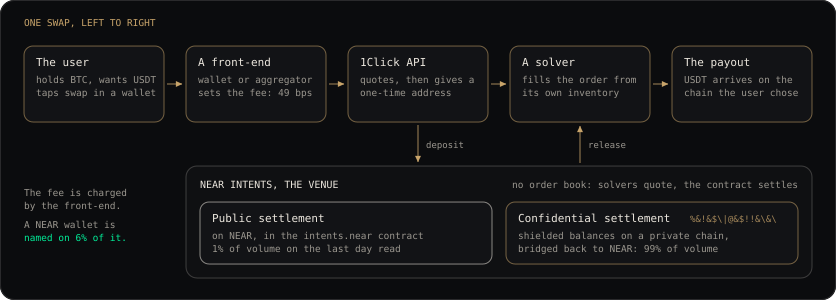

**Figure 1.** One swap, end to end. The user sees a wallet. The front-end sets the fee. Solvers quote, and NEAR Intents settles, now almost always out of public view.

A claim like that is easy to like and hard to check. So we cut it into pieces that can each fail.

- **H1. The venue has customers who pay.** Sections 3.1 to 3.3.
- **H2. Going private didn't cost it volume.** Section 3.4.
- **H3. NEAR keeps very little of what the venue earns.** Section 4.
- **H4. That share is going up.** Section 4, on the official monthly series.

Section 5 asks what any of this is worth to the token. Section 6 is the bear case. Section 7 lists what would change our mind, re-tested on every build.

## 2. Data and method

### 2.1 Sources

**Table 1.** Where each number comes from.

| Source | What we take | Reference |
|---|---|---|
| NEAR Intents Explorer API | Every partner swap in the window: status, value, fees, fee recipients, the coins on each side, the referring front-end | [1] |
| DefiLlama | Official daily volume, fees and revenue; volume of three peer venues | [2], [15] |
| NEAR's Dune queries | Confidential volume by day, volume by token, swap counts | [3], [4], [5] |
| NEAR RPC and archive | Revenue-wallet balances, total supply, the issuance setting, contract holdings, contract state | [8] |
| NEAR documentation and dashboard | The published fee schedule, dates of changes, how NEAR's take splits | [9], [10] |

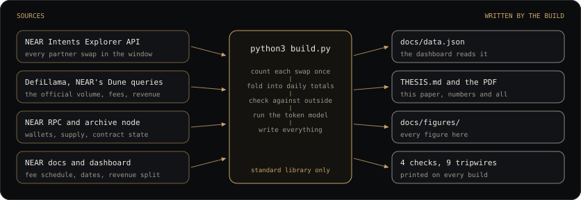

**Figure 2.** The whole paper is the output of one command. Sources on the left, what the build writes on the right.

### 2.2 Counting rules

- **A partner swap** is one record from the Explorer API. Records are de-duplicated by deposit address and memo and counted once. Dollar values are the API's own; we don't re-price them.
- **Fees** are the fees the front-end set on the swap. A fee is **named to NEAR** when its recipient is one of NEAR's three revenue wallets.
- **Kind of swap.** Two stablecoins make a stablecoin pair. Otherwise it's Bitcoin if either side is BTC, then Zcash if either side is ZEC, then "other UTXO coin" for Litecoin, Dogecoin and Bitcoin Cash, then everything else.
- **Two units of volume.** NEAR's official volume is a sum of volume per token, so one swap is in there twice, once under each coin (Section 3.5). We call the official figure halved **swap value**, and we only compare partner swaps with the official figure on the both-sides basis.
- **History.** Before the window we counted three full days a month, the 5th, 15th and 25th, from June 2025.
- **Chain reads.** Balances, supply and contract state are read at the last block of each day from an archive node. No prices are involved in those series.
- **What is kept.** The API's terms don't allow single records to be stored, so the repository holds daily totals only. A full re-run needs your own free API key; `python3 build.py --offline` rebuilds everything else from the saved totals.

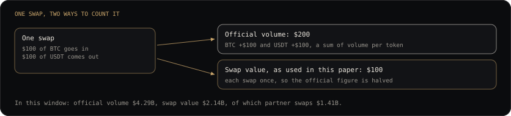

**Figure 3.** Why the official volume is twice the swap value. Every comparison in this paper is made in one unit or the other, never across them.

### 2.3 Definitions

Three ratios do most of the work below. With *F* the fees charged on a volume *V*, the rate in basis points is

$$\text{rate} = 10^{4}\cdot\frac{F}{V} \qquad (1)$$

With *R* NEAR's revenue and *G* the gross fees on the official series, the capture is

$$\text{capture} = \frac{R}{G} \qquad (2)$$

And with *s* the share of each front-end, the effective number of front-ends is

$$N_{\text{eff}} = \frac{1}{\sum_i s_i^{2}} \qquad (3)$$

which is 1 when one front-end has everything and *n* when *n* of them split it evenly.

### 2.4 Checks

We don't ask you to trust our counting. The build compares its own numbers with outside ones and prints the result every time it runs.

- **The official fee figure is what partners charge.** On the sampled days of 2025 the fees counted from single swaps come to 100.0% of the official fee figure for the same days.
- **The revenue wallets grew by about what the official revenue says.** The three wallets hold 481,223 NEAR more than 30 days earlier, about $1,437,534 at today's price, against $1,658,916 of official revenue. The gap includes price moves and anything the wallets paid out.
- **Two ways of reading the revenue wallets agree.** Over 30 days our archive-node balances show 405,284 NEAR arriving; SQL over the chain's transfer tables (a third party's saved Dune query) shows 405,283. The largest gap on any one day is under 1 NEAR.
- **The official volume counts both sides of every swap.** It is a sum of volume per token, so a swap of Bitcoin for dollars is in it twice. Counting our partner swaps the same way (every swap that touches a token), we get 81% of the official BTC volume, 78% of the official SOL volume, 99% of the official XRP volume over 15 days. A one-sided official figure could not be matched this closely. So we compare partner swaps to the official total on the both-sides basis throughout.

### 2.5 Reproducing this paper

    python3 build.py                 # count, read the chain, run the model, write this paper
    python3 build.py --offline       # the same from saved daily totals, no key needed
    python3 -m pipeline.model --cut 0.5 --growth 2 --cap 0.016
    python3 -m unittest discover -s tests

The pipeline uses only Python's standard library. SQL for the Dune side is in `queries/`, with a note on which files we could run and which we couldn't.

## 3. Results

### 3.1 Nobody opens a NEAR app

715,169 partner swaps attempted in 30 days, 658,719 of them completed, worth $1.41B. Up to 149 different wallets and apps sending flow on a single day. The biggest, SwapKit, carries 41% of it, and its fee accounts are named for Ledger, Trust, Tangem and Trezor [12]. You may have heard of them. (It used to be nearly the whole thing: 98% of the volume on 25 June 2025. The crowd around it is new.) Zcash's own wallet routes its swaps here too [13].

None of these users "use NEAR" in any way they'd recognise. That's the point. It's also the first warning: the customer belongs to the front-end (Figure 4). By volume the flow behaves as if it came from 4.5 equal front-ends (Equation 3). By fees, 1.5.

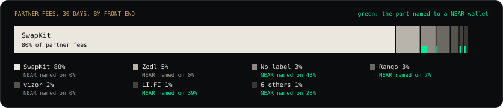

**Figure 4.** Partner fees by front-end, 30 days. One integrator produces 80% of them.

### 3.2 Who's paying?

Here's the part we didn't expect. The best customers aren't DeFi natives shuffling stablecoins. They're holders of coins that can't run a swap on their own chain.

- **Bitcoin:** 33% of partner volume, 57% of partner fees, 84 bps.
- **Zcash:** 57 bps.
- **Stablecoin pairs:** 38% of the volume... and 11 bps.

Bitcoin, Zcash, Litecoin, Dogecoin and Bitcoin Cash together are 42% of the volume and 68% of the fees (Figure 5). If you hold a coin with no exchange at home, you pay up to leave. NEAR is the door. (XRP does have an exchange of its own and still pays 91 bps here. Make of that what you will.)

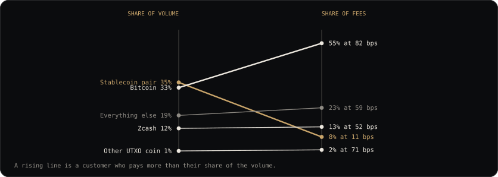

**Figure 5.** Share of partner fees (bright) against share of partner volume (dim), by what is swapped. The price follows the customer's alternatives, not the size of the flow.

### 3.3 From lunch money to real money

On 5 June 2025 partners charged $43. Not a typo. In this window it's $228K a day (Figure 6). Front-ends active in a day went from 5 to 149.

And the mix keeps rotating underneath. Bitcoin was 97% of partner volume on 25 June 2025. Zcash was 53% on 15 October 2025. Stablecoin pairs are 38% now. Three different stories in 17 months, and the fees showed up for all of them. The venue doesn't need to pick the winner.

One caveat before anyone gets carried away: against a year ago, partner fees a day are only 1.1x ($212,455 then, $227,959 now). Most of the climb happened in 2025.

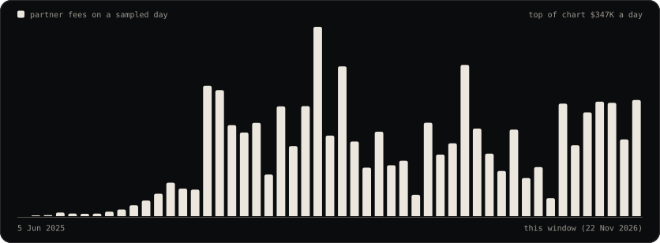

**Figure 6.** Partner fees on each sampled day since June 2025. The last bar is the daily average of this window.

### 3.4 Lights out

Confidential volume first showed up on 23 March 2026 [3]. For months it was a rounding error. In the second half of October it was 43% of the total. From 4 November 2026: 97%. On 12 November 2026: 99% (Figure 7).

In about a week, the whole venue went dark.

What makes that interesting rather than alarming is that volume didn't flinch: $120.6M a day before, $136.4M a day after. NEAR's changelog dates the switch for partner swaps to 27 October 2026, and says partners didn't have to change anything [9].

What is it, mechanically? The same changelog (13 July 2026) describes confidential swaps as executing on a private chain with shielded balances and settling back to public NEAR through a bridge. That fits what the chain shows in Section 3.6: the swaps vanished from view, the money didn't move.

To be clear about what "private" means here: private from the chain, not from the operator. More on that in the bear case.

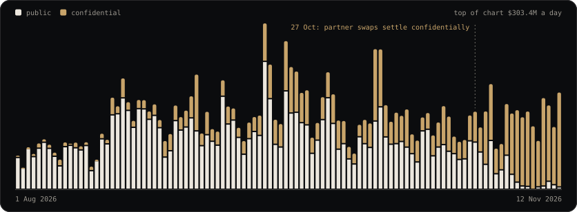

**Figure 7.** Official volume by day. Brass is the part NEAR's dataset marks confidential. H2 holds. The venue went dark and nobody left.

### 3.5 The other side of the ledger

A word on the headline number, because it tripped us up for a while.

NEAR's official volume is a sum of volume per token [4]. Swap Bitcoin for dollars and that one swap is in there twice: once under BTC, once under USDT. It isn't wrong, it's just a different unit, and DefiLlama carries it as is.

How do we know? Token by token, over 15 days, partner swaps that touch a token come to 99% of the official XRP volume, 81% of the official BTC volume, 78% of the official SOL volume, 55% of the official ZEC volume. You can't get that close to a one-sided number.

So what's the rest? Counted on the same basis, partner swaps are 66% of official volume. The other 34% is not a mystery asset class. It's dollars. 95% of the gap is USDT and USDC that never touches the partner API (partner swaps are only 41% of official USDT and 43% of official USDC). Stablecoins changing chains.

And it does pay, just at stablecoin prices. Take partner fees out of the official fee figure and $1.2M is left: about 16 bps on that flow. Stablecoin pairs inside the partner API pay 11. Same product, same price. What differs is who collects. NEAR's own revenue dashboard (13 November 2026) splits what it keeps three ways, as shares of gross fees: 19.3% from its own front-end, 10.4% from partners, 3.6% from quote improvement. So about 58% of NEAR's take comes from its own app. NEAR earns more from the half it owns than from the half that made it famous.

And it isn't whales. By NEAR's own swap counts that is roughly 224,715 swaps in 15 days at about $1,799 each. Partner swaps average $2,141. Ordinary-sized transfers, and a lot of them.

### 3.6 What the chain says

Everything above leans on NEAR's own API. So we went to the chain, with no key and no dashboard, and read 73 days of it from an archive node.

- **The wallets.** The three revenue wallets took in 480,958 NEAR over the window. Total supply grew by 2,643,921 NEAR in the same days. That's 18.2%, from balances and supply alone. No prices involved.
- **A meter nobody publishes.** The intents contract stores 14.3 GB of state on chain. It grew 28 MB a day before the switch and 44 MB a day after. Going private did not make the public footprint smaller.
- **The money never left.** The contract's 6 largest holdings averaged $135.2M before the switch and $138.9M after, at today's prices. Volume went private; the float stayed where anyone can count it.
- **And it checks out.** A third party's SQL over the chain's transfer tables gives the same wallet inflows as our archive reads, to within 1 NEAR a day (Section 2.4).

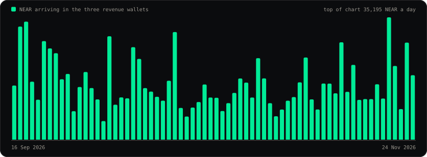

**Figure 8.** NEAR arriving in the three revenue wallets each day, from balances at the last block of the day.

### 3.7 The neighbours

If a wallet wants to swap native Bitcoin, these are the places it can send the order. Over the same 30 days DefiLlama shows THORChain $4.94B, Chainflip $1.04B, Maya $176.3M. NEAR Intents is listed at $4.29B, which is $2.14B once you count each swap once. That makes it number 2 of 4.

Two honest footnotes. We halved NEAR's number and left the others as reported, because we only audited NEAR's. And SwapKit, the biggest sender of flow here, routes to THORChain, Chainflip and Maya as well. The flow is earned every day, not owned.

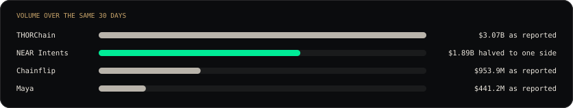

**Figure 9.** Volume over the same 30 days at venues that swap native assets between chains. NEAR's figure is halved to count each swap once; the others are as reported.

### 3.8 What happened on those days

Charts jump on particular days, and a number without a reason invites a story. So for each day that stands out we went looking for what was announced. The left column is measured by the build. The right column is what a public source says, with the link, and we did not measure it. Where we found nothing, we say so.

**Table 2.** Days that stand out, and what was announced.

| Date | What our data shows | What was announced | Source |
|---|---|---|---|
| 24 Feb 2026 | NEAR's share of gross fees goes from 8% in January to 16% in February. | NEAR announces that the Intents fee switch is live: protocol fees go to NEAR, and distribution fees are shared between NEAR and its partners. | [NEAR blog, "Evolving NEAR Tokenomics"](https://www.near.org/blog/evolving-near-tokenomics) |
| 23 Mar 2026 | Confidential volume appears in NEAR's dataset for the first time. | We found no announcement for that day. |  |
| 5 Jun 2026 | One of the largest days on record: $282M of official volume. | Zcash fell by about a third in a day after a counterfeiting bug in its Orchard pool was disclosed. NEAR Intents is a major place to swap Zcash. Nobody official has linked the two. | [Zcash community forum](https://forum.zcashcommunity.com/t/the-orchard-counterfeiting-vulnerability-and-next-steps/56015) |
| 13 Jul 2026 | Confidential volume is still a small share. | Confidential Intents goes live for business partners: swaps execute on a private chain with shielded balances and settle back to public NEAR. | [NEAR Intents changelog](https://docs.near-intents.org/changelog/overview) |
| 17 Sep 2026 | The largest day on record, $303M, and the largest inflows to NEAR's revenue wallets. | We could not confirm a cause from a source we can link. |  |
| 27 Oct 2026 | The confidential share is 40% that day. | 1Click swaps settle confidentially by default from this day. The API is unchanged, so integrators change nothing. | [NEAR Intents changelog](https://docs.near-intents.org/changelog/overview) |
| 29 Oct to 5 Nov 2026 | The confidential share climbs from 69% to 97%. | We found no announcement of a staged rollout. It looks like the 27 October default taking effect. |  |
| 4 and 5 Nov 2026 | 41,457 swaps are refunded with one error, INTENT_SUBMIT_FAILED, against 1 the day after. Completed swaps hold at 20,368 to 21,017 a day. | We found no incident report. A burst of one error with completed swaps unchanged points to one sender retrying, not to users being failed. Daily totals cannot show which sender. |  |
| 9 Nov 2026 | The confidential share dips to 92% the next day. | Tokens on BNB Chain, Polygon and Avalanche move to new asset IDs. We cannot say the two are related. | [NEAR Intents changelog](https://docs.near-intents.org/changelog/overview) |
| 11 Nov 2026 | The partner share of official volume has not moved by the end of the window. | The old Bridge API closes, and integrators are told to use the 1Click Swap API. | [NEAR Intents changelog](https://docs.near-intents.org/changelog/overview) |

Three things follow. The move to confidential settlement was a default being switched, not users choosing privacy one by one. The ugly refund day was one error repeated, while completed swaps carried on as normal. And NEAR's rising cut began with a decision NEAR announced.

## 4. So where's the money?

Some of it is sitting inside. The intents contract held about $188.8M when we built this (166 of 166 listed tokens could be read).

Some of it lands in wallets anyone can read (Section 3.6).

Put the two halves side by side (Figure 10).

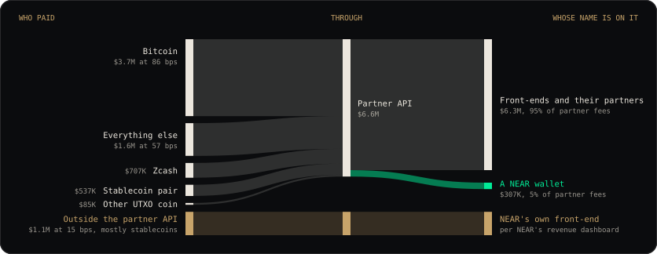

**Figure 10.** Every fee dollar of the window. The thin green ribbon is the 3% of partner fees with a NEAR wallet's name on it.

**Table 3.** The two halves of the venue, same 30 days.

| | Share of volume | Fees charged | Rate | What NEAR gets |
|---|---|---|---|---|
| Partner API (wallets, aggregators) | 66% | $6.8M | 48 bps | named on $234K |
| Everything else (mostly stablecoins) | 34% | $1.2M | 16 bps | booked to its own front-end, per its dashboard |

Official revenue for the window is $1.7M. The famous half does the volume and the pricing. The quiet half does most of the earning.

That quiet half has a name, by the way. NEAR's own front-end is near.com, which The Defiant describes as an account product built on NEAR Intents that lists perpetual futures, tokenized stocks, bonds and precious metals alongside crypto [14]. So "becoming an exchange" isn't only a metaphor for what happens behind other people's wallets. NEAR is building the storefront too.

Now the uncomfortable number, and it's H3. Of the $6.8M partners charged, a NEAR wallet is named on $234K. NEAR's own published fee schedule says it takes half [9].

And the schedule is real, for some. LI.FI charges 4 bps and a NEAR wallet is named on 39% of it, which is the published split to the decimal. SwapKit carries 3.1 times LI.FI's volume, charges 96 bps, and names NEAR on none of it. The biggest customer got the best deal. It usually does.

Here's the thing, though: it's already moving. Month by month, on the official series, NEAR kept 10% of gross fees in November 2025, 4% at the low in December 2025, and 34% in October 2026. Revenue went from $768K to $2.2M a month over the same stretch. This one isn't a mystery. NEAR switched fees on at the end of February 2026 [16], and its own front-end keeps all of what it charges [17]. What hasn't moved is the partner side, and that is where the money is.

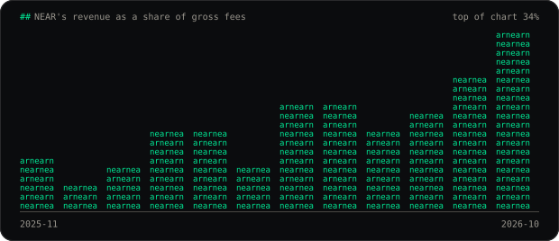

**Figure 11.** NEAR's revenue as a share of gross fees, month by month, on the official series. H4 holds. The step up in February is the fee switch.

## 5. What's it worth to the token?

The bull case fits in one line: **the upside is a setting, not a new market.** Take the published half and revenue goes from $1.7M to $4.8M per 30 days, from 21.0% to 61.3% of the dollar value of new issuance. No new customers required. (The other lever, charging 5 bps more on the stablecoin half, only gets you to 25.7%.)

There's a second lever, and this one is already pulled. On 2 November 2026 NEAR's governance voted to lower the issuance cap from 2.5% to 1.6%, phased in over two years [11]. At 1.6% today's revenue covers 32.8% instead of 21.0%; with the published half as well, 95.8%.

The model is a few lines. Revenue in a window, as a function of NEAR's cut *c* of partner fees, an extra fee of *b* basis points on swap value outside the partner API, and volume growth *g*:

$$R(c, b, g) = g\left[(R_0 - c_0 F) + cF + \frac{b}{10^{4}}V_o\right] \qquad (4)$$

Here *R*0 and *c*0 are today's revenue and cut, *F* is partner fees and *V*o is swap value outside the partner API. Issuance, in dollars, at an issuance cap of *κ* against today's *κ*0 = 2.5%, with *N* the net new NEAR in the window and *P* the price:

$$I(\kappa) = N \cdot P \cdot \frac{\kappa}{\kappa_0} \qquad (5)$$

The share of issuance that revenue covers, and the cut that would cover all of it at today's volume:

$$C = \frac{R}{I} \qquad (6)$$

$$c^{*} = \frac{I - (R_0 - c_0 F)}{F} \qquad (7)$$

Today *c*\* is 95%. And the multiple, with *S* the supply and *T* the days in the window:

$$M = \frac{S \cdot P}{R \cdot 365 / T} \qquad (8)$$

**Table 4.** Scenarios. Inputs are measured by the build; the levers are assumptions.

| Case | Revenue per 30 days | Per year | Share of new issuance | All NEAR / a year of it |
|---|---|---|---|---|
| Today | $1.7M | $20.2M | 21.0% | 194x |
| NEAR takes its published half of partner fees | $4.8M | $58.9M | 61.3% | 67x |
| Swaps outside the partner API pay 1 bp more | $1.7M | $21.1M | 21.9% | 186x |
| Swaps outside the partner API pay 5 bps more | $2.0M | $24.6M | 25.7% | 159x |
| Published half, and volume triples | $14.5M | $176.8M | 184.0% | 22x |
| Nothing changes but volume halves | $829K | $10.1M | 10.5% | 389x |
| Issuance at the 1.6% cap already voted in | $1.7M | $20.2M | 32.8% | 194x |
| Published half, at the 1.6% cap | $4.8M | $58.9M | 95.8% | 67x |
| The largest integrator (SwapKit) leaves | $1.7M | $20.2M | 21.0% | 194x |

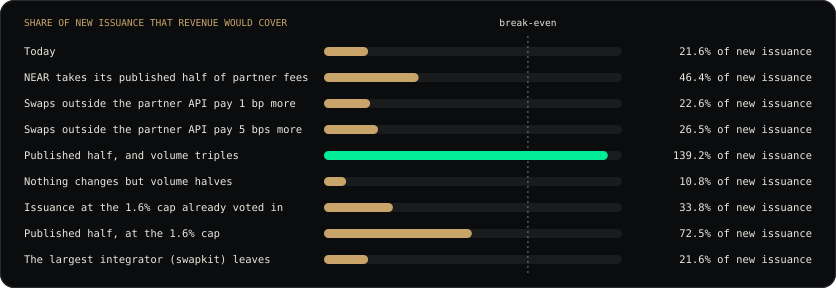

**Figure 12.** The scenarios of Table 4, as the share of new issuance that revenue would cover. At today's volume nothing gets to 100% on its own.

The model assumes every dollar of revenue could buy NEAR and a NEAR price of $2.99. Issuance is the net new NEAR the chain actually created in the window, read from total supply. At today's price every NEAR in existence is worth 194 times a year of this revenue; at the published half, 67 times. Nobody is buying NEAR for today's fee line.

## 6. The bear case

Evidence against. We'd be doing the thing we make fun of if we stopped at the bull case. Here's how we could be wrong, roughly in the order it worries us.

1. **The maths doesn't close yet.** To match issuance at today's volume NEAR would need 95% of partner fees. At the published half it needs 1.6x the volume; at today's cut, 4.8x.
2. **It's one integrator.** SwapKit produces 80% of partner fees, which is 69% of every fee NEAR Intents reports. NEAR is named on none of them. If that relationship sours, every chart here looks different. (Run the model with them gone: partner fees fall to $1.3M, and NEAR's revenue in the records doesn't move, because it was never named on those fees. Either NEAR is paid some other way, or it is giving away its biggest channel.)
3. **The cut may be thin for a reason.** $234K of $6.8M. The partners own the customer, and whoever owns the customer sets the terms.
4. **Half the volume is thin.** Counted the same way, partner swaps are 66% of official volume and 85% of official fees. The other 34% brings the remaining 15%. 95% of that gap is USDT and USDC, paying about 16 bps. Useful, and NEAR's own, but stablecoin margins won't carry the token.
5. **Whales.** The largest 1% of swaps carry 52% of partner volume.
6. **The switch broke things.** On 5 November 2026, 62% of swaps were refunded or failed. Over the whole window 7.9% didn't complete. Strip out the worst days and it's 1.9%... but users don't get to strip out the worst days. (Table 2 has the detail: almost all of it was one error, and completed swaps never dipped.)
7. **"Private" has an asterisk.** Every swap we counted was read from NEAR's own Explorer API [1], after the switch. Users trust the operator the way they'd trust an exchange, and an exchange without identity checks carries regulatory risk that no chart here can measure.
8. **It's small next to issuance.** $1.7M of revenue in 30 days against roughly $7.9M of new NEAR. Halve the volume and cover falls to 10.5%.
9. **The official series moved the goalposts.** DefiLlama's volume [2] counts confidential volume only from 1 September 2026, which flatters growth across that date. Worth knowing before you draw a trendline.

## 7. What would change our mind

Every line gets re-tested on each build. 1 of 9 is tripped right now.

**Table 5.** Tripwires.

| Tripwire | Now | State |
|---|---|---|
| Partner swaps fall below 40% of official volume, counted the same way | 65.8% | not tripped |
| One front-end carries more than 60% of partner volume | 40.6% | not tripped |
| One front-end produces more than 85% of partner fees | 80.5% | not tripped |
| NEAR is still named on under 10% of partner fees | 3.4% | **tripped** |
| More than 5% of swaps fail or refund on ordinary days | 1.9% | not tripped |
| Revenue covers under 10% of new NEAR issued | 21.0% | not tripped |
| Daily volume after the switch is under 70% of before | 113.1% | not tripped |
| Partner fees a day fall below their level a year ago | 107.3% | not tripped |
| NEAR keeps under 20% of gross fees in the latest full month | 34.3% | not tripped |

## 8. The Hyperliquid rhyme, and the trade

We're not going to compare numbers with Hyperliquid, because they aren't comparable. The shape is.

Hyperliquid showed what happens when the liquidity for one thing gathers in one decentralised venue. Everybody else plugs in rather than building their own, and the venue gets very hard to route around. NEAR Intents is taking that seat for moving value between chains, above all for coins with no exchange at home.

The tell is who sends the flow: aggregators that can route anywhere send swaps here (LI.FI 13%, Rango 6%, SwapKit 41% of partner volume). Aggregators have no loyalty, which is exactly why it matters that they keep showing up.

So what's the trade? Long the venue, with eyes open about the token. The business is real and it grew without anyone noticing. What the token gets out of it is, today, a rounding error on a fee somebody else collects. So the thing to watch isn't volume. It's the cut.

## 9. What we couldn't pin down

- Who sends the other 34% of official volume. We know what it's made of and roughly what it pays (Section 3.5); NEAR's dashboard points at its own front-end.
- Whether NEAR Intents gives the best price. Aggregators routing to it suggests so, but we ran no price comparison, so we aren't claiming "the best liquidity".
- Exactly how the fees on the stablecoin half split between NEAR's wallets. We get the total by subtraction and the attribution from NEAR's dashboard, not from single swaps.
- What the closing of the old Bridge API on 11 November 2026 does. NEAR's changelog tells integrators to use the 1Click API instead [9]. If some of that flow came through the old door, the partner share should rise over the next weeks. Through 26 November 2026 it hadn't.
- How NEAR's dataset decides that a dollar of volume is "confidential".
- How much of NEAR's partner revenue arrives outside the swap records. NEAR's own dashboard implies somewhat more than the 3% named in them.
- The path between history points. Before the window we counted three days a month.
- Whether the neighbours' volumes are counted the way NEAR's is. We audited the unit of NEAR's figure only.
- The SQL we wrote or adapted ourselves in `queries/` was never run by us, because the Dune account we used can read saved results and can't execute queries. Where a query matters to this paper we read the saved result of the public original.
- The daily rebuild is new. If a run fails, the numbers stay at the last good build, and the date at the top says when that was. The public and confidential split, the volume per token and the swap counts are saved copies of NEAR's Dune results from 14 November 2026, so the sections that use them do not move with the daily build.

## Appendix A. The scorecard

**Table A1.** Every figure the build reports, with its basis.

| Group | Figure | Now | Basis |
|---|---|---|---|
| Scale | Swap value settled | $2.14B | 30 days; official volume halved, because it counts both sides |
| Scale | Of which partner swaps | $1.41B | 66% of the total |
| Scale | Partner swaps completed | 658,719 | 21,957 a day |
| Scale | Wallets and apps sending swaps | 149 | most on a single day |
| Scale | Swaps under $100 | 61% | share of completed swaps |
| Scale | Swaps of $100K or more | 30% | share of partner volume, from 1,861 swaps |
| Scale | Partner share of official swap count | 55% | counted per token, like the volume |
| Scale | Swaps outside the partner API | 224,715 | 15 days; $1,799 each on average, against $2,141 for partner swaps |
| Scale | New contract state | 1,221 MB | 30 days of intents.near storage growth |
| Scale | Held by the contract, six largest tokens | $141.1M | at today's prices |
| Take | Fees partners charge | $6.8M | 48 bps of partner volume |
| Take | All-in cost to the user | 59 bps | dollars in minus dollars out |
| Take | Named to a NEAR wallet | $234K | 3.4% of partner fees |
| Take | Fees on swaps outside the partner API | $1.2M | 16 bps; official fees less partner fees |
| Take | NEAR's revenue, official | $1.7M | 7.7 bps of swap value |
| Take | The 1-pip protocol fee earned | $2,346 | 30 days to 2026-11-04, of $6.1M gross fees |
| Take | NEAR's share of gross fees | 34% | 2026-10; it was 10% in 2025-11 |
| Customers | Coins with no exchange at home | 68% | share of fees, from 42% of volume |
| Customers | Bitcoin swaps pay | 84 bps | stablecoin pairs pay 11 |
| Concentration | Largest front-end, share of volume | 41% | swapkit |
| Concentration | Largest front-end, share of fees | 80% | swapkit |
| Concentration | Front-ends that matter | 4.5x | effective number: 1 / sum of squared volume shares |
| Concentration | Largest 1% of swaps | 52% | share of partner volume |
| Token | NEAR into the revenue wallets | 480,958 NEAR | 30 days, read from chain |
| Token | Net new NEAR | 2,643,921 NEAR | 30 days, from total supply on chain |
| Token | Inflow against new supply | 18% | both read from chain, no prices |
| Token | NEAR in the revenue wallets | 4,542,542 NEAR | 0.35% of supply |
| Token | Revenue against new issuance | 21% | dollars; the model's base case |
| Token | All NEAR at today's price, over a year of this revenue | 194.3x | supply x $2.99, against $20.2M a year |
| Token | Cut that would match issuance | 95% | NEAR's share of partner fees, at today's volume |
| Token | Volume that would match issuance | 1.6x | at the published half of partner fees |
| Privacy | Confidential share of volume | 99% | on 2026-11-12; 43% in the second half of October |
| Reliability | Swaps that fail or refund | 1.9% | ordinary days; 62% on 2026-11-05 |
| Growth | Partner fees a day, against a year ago | 1.1x | $212,455 then, $227,959 now |
| Growth | Official fees, against the same days a year ago | 1.0x | $7.7M then, $8.0M now; every day counted, not sampled |
| Growth | Official revenue, against six months ago | 2.8x | $0.59M then, $1.66M now |

## References

1. NEAR Intents Explorer API. Every settled partner swap in the window, read with the author's key (`pipeline/swaps.py`).
2. DefiLlama. Daily volume, fees and revenue for NEAR Intents, which DefiLlama takes from NEAR's own Dune dataset: api.llama.fi/summary/dexs/near-intents and api.llama.fi/summary/fees/near-intents (`pipeline/official.py`).
3. NEAR. Dune query 5179085, "NEAR Intents - All-time Volume": public and confidential volume by day. dune.com/queries/5179085 (`data/confidential.csv`).
4. NEAR. Dune query 5157527, "NEAR Intents - Token Volume": volume by token and day. dune.com/queries/5157527 (`data/official_tokens.csv`).
5. NEAR. Dune query 4374089: swap counts by day. dune.com/queries/4374089 (`data/official_swaps.csv`).
6. Third party. Dune query 9074851: what the protocol fee earns next to what front-ends charge. dune.com/queries/9074851.
7. Third party. Dune query 6740088: NEAR arriving in the revenue wallets, from chain tables. dune.com/queries/6740088 (`data/dune_wallet_inflows.csv`).
8. NEAR mainnet RPC and archival RPC (FastNEAR). Wallet balances, total supply, the issuance setting, contract holdings and contract state, 73 days of it (`pipeline/chain.py`, `pipeline/history.py`).
9. NEAR Intents documentation: the fee schedule, and the changelog entries of 13 July, 27 October and 11 November 2026.
10. NEAR. Revenue dashboard, revenue.near.org: how NEAR's take splits by mechanism.
11. NEAR Protocol. Announcement of the issuance vote, HSP-029. x.com/NEARProtocol/status/2117338455189385533.
12. Ledger. "NEAR Intents joins Ledger Wallet via SwapKit". ledger.com/blog-near-intents-joins-ledger-wallet-via-swapkit.
13. Zodl. Swaps powered by NEAR Intents in the Zcash wallet. zodl.com/zashi-swaps-decentralized-on-ramp-is-live.
14. The Defiant, 18 September 2026, on near.com. thedefiant.io/news/markets/bitcoin-81000-near-tokenization-tokens-lead-rally-sep-18-2026.
15. DefiLlama. Daily volume for THORChain, Chainflip and Maya (`pipeline/official.py`).
16. NEAR. "Evolving NEAR Tokenomics", 24 February 2026: the Intents fee switch. near.org/blog/evolving-near-tokenomics.
17. NEAR. "The State of NEAR: Q2 2026", 8 July 2026: fee capture and the owned front-end. near.org/blog/the-state-of-near-q-2-2026.
18. Zcash community forum. "The Orchard Counterfeiting Vulnerability, and Next Steps", June 2026. forum.zcashcommunity.com/t/the-orchard-counterfeiting-vulnerability-and-next-steps/56015.

## Disclosure

Not investment advice. Written for the NEAR hackathon, thesis track. This text is generated by `pipeline/thesis.py` from the build's numbers; most of the code, and the wording, were drafted with an AI coding assistant (Claude Code) and directed, checked and corrected by the author.
